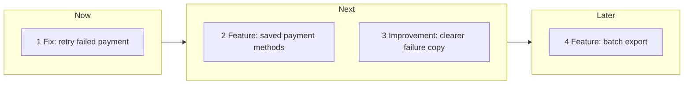

# Threads mode (engineer as product owner)

Default when `/product-spine` has no args, when the arg is `threads`, or
when the phrasing is "what should we build next", "suggest features",
"suggest improvements", "what's next", or similar.

This mode **writes no files**. It proposes work. Landing a proposal is draft
mode ("draft 3", "land 2 as an epic"). There is no `docs/product/threads/`
path and no fourth artefact type.

Read this file when running threads. Subagent briefs below are the gather;
do not invent a fourth brief or a fourth context path.

## Fan-out (required when the host can spawn subagents)

Call the Task tool (or the host's equivalent subagent tool) **2 to 4 times
in one turn**, in parallel, each with one brief below. Subagents are
**read-only**: no patches, no new files, no `src/` edits. Each returns
citations (paths and a short finding) or `absent` / `unknown`.

If the host has no Task / subagent tool, run the same three briefs
**sequentially this turn** in the parent. Never retry a denied or failed
call. Never guess an alternate path.

Do not Call the Skill tool with another user-invoked skill from here.

## Brief 1: Spine

Read or list, each once, best-effort:

- `docs/product/one-pager/current.md` (and `docs/product/one-pager/TEMPLATE.md`
  if present)
- `docs/product/epics/*.md`
- `docs/product/briefs/*.md`
- directory names under `openspec/changes/` (in-flight changes; absence is
  fine; do not read or write files inside)
- `docs/product/context/platform-primer.md`
- `docs/product/context/capability-gaps.md`
- `docs/product/context/golden-path/*.md`

Return: which files exist; §3 bets and §4 initiative **heading text**; epic
titles and ladder lines; brief titles, `Status`, `Suggested change:`, and
`Part of:` / `Ladders to:`; in-flight change folder names; primer section
names; gap one-liners. Invent nothing. Name absences. Do not propose a
thread that duplicates an existing brief title or change folder name.

## Brief 2: Surfaces

Read-only scan of how the product is used and what the repo already flags:

- project `README.md` (and a short recent `git log --oneline` if git works)
- user-facing entry points (routes, CLI help, main screens): locate with
  grep, then read only the hit
- `TODO` / `FIXME` / `XXX` hits in source (path plus the line, not a patch)

Return: friction the README or code already states, with paths. No
implementation. If git or grep is denied, say unavailable and continue.

## Brief 3: Friction

From the Spine and Surfaces findings (or by reading the same paths if
running sequential):

- gaps in `capability-gaps.md` versus what the primer actually offers
- thin or orphaned ladder lines (brief/epic pointing at a heading or file
  that is missing)
- signals that users cannot complete the job today (now-shaped), cited

Return: each friction with a path, or `unknown`. Do not answer capability
`Yes today` from memory.

## Synthesize (parent only)

After the briefs return, emit **4 to 8** threads mixing **Feature**,
**Improvement**, and **Fix**. If evidence is thin, emit as many as you can
ground (at least two) and mark `thin`. Prefer a mix of kinds over eight
copies of one kind.

No invented metrics, baselines, or platform nouns. If the primer is absent,
do not claim what the platform can do today.

### Card schema (every thread)

```
N. **[Kind]** <title>
   Need: who / friction / outcome (one line)
   Evidence: <path>[, <path>]
   Artefact: brief | epic
   Ladder: <epic path> | docs/product/one-pager/current.md §4 <heading> |
           (one-pager not yet written)
   Confidence: grounded | thin
```

`Kind` is exactly one of `Feature`, `Improvement`, `Fix` so greps match.
`grounded` means at least one evidence path exists on disk and supports the
need. `thin` means the need is inferred from a weak signal (a TODO, a
README wish); still cite that path.

Suggested artefact: `epic` when the work is a feature in flight with
discovery; `brief` when it is one product slice for a change proposal.

## Visual: mermaid in chat (not a vendor canvas)

The first block of the threads reply is a mermaid **flowchart** with three
subgraphs, `now`, `next`, and `later`. Node labels are `"N Kind: short
title"`. No spaces in node IDs. No `end` as an ID. No vendor canvas file.

Skeleton (replace the example nodes with this run's threads):



Put **Fix** / users-cannot-complete-the-job work in `now` when evidence
says so. `later` is valuable-but-not-this-cycle. If you only have two
threads, omit an empty subgraph rather than drawing placeholders.

## Reply shape

1. `## Thread map` then the mermaid fence.
2. `## Threads` then the numbered cards.
3. Closing line (exact job, not a new heading): pick a number to draft, or
   name `review` / `capability`.

Never re-dump a spine file into chat. Never write `Status: ready` or
`ready-to-propose`. Never create mockups.

## After the user picks

"draft 3", "land thread 2", "draft 1 as a brief", "draft 1 as a task" is
**draft mode** with that card as inline context. Read
[draft-mode.md](draft-mode.md). Write the artefact this turn when the card
already has need and ladder. For a brief, TBD constraints are enough when
the user picked the card and did not supply In / Out.
