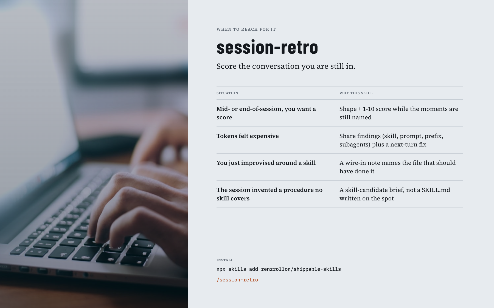

# session-retro

**Score the conversation you are still in.** A shape, a score, and wire-ins, before the reasoning collapses into a log.



```text
/session-retro
/session-retro --since <marker>
/session-retro --focus tokens
/session-retro --focus wiring
```

- **Live snapshot.** Shape plus an `N/10` score while the moments still have names, not after they become counts.
- **Token findings in relative magnitude.** Share of this session (which skill, which turn, prefix breaks, subagent fan-out), each with a next-turn action. It does not invent per-turn numbers the host never gave it.
- **Wire-ins that name the file that runs.** The workaround you just improvised becomes a note on the skill you called. Point it at an on-disk transcript and it refuses: re-reading a log re-pays for context it already holds.

You type it. The agent will not start a retro in the middle of your work.

## Install

```bash
npx skills add renzrollon/shippable-skills
```

Pick the hosts you use, then type `/session-retro`. Claude Code plugin path and the "do not install twice" rule are on the [collection README](../../../README.md).

## More

- [Human docs](../../../docs/productivity/session-retro.md): when to reach for it, common questions, what "working" looks like
- [Agent instructions](./SKILL.md): what the model follows once you invoke it
- [Changelog](./CHANGELOG.md): 0.1.0 gate; 0.2.0 token analysis
